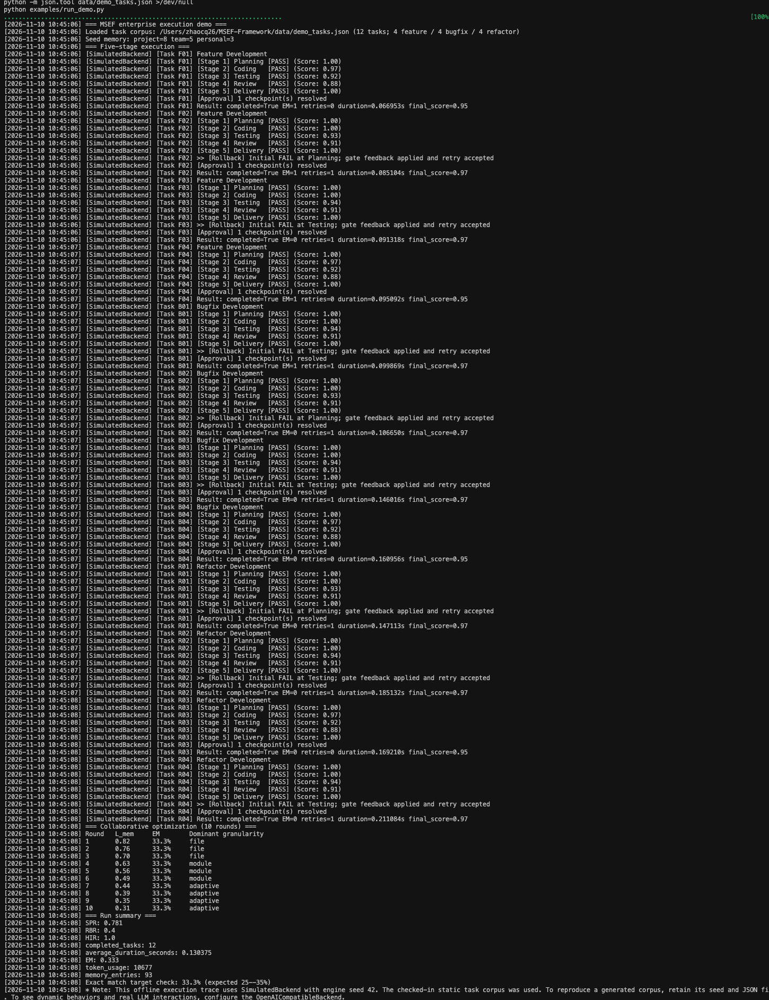
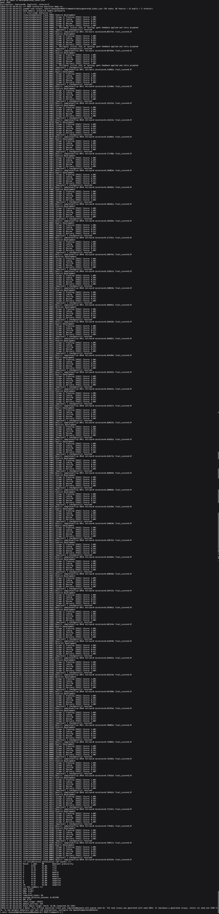

# MSEF: An LLM Agent-Driven Multi-Stage Execution Framework for Enterprise Software Engineering

This repository implements the **Multi-Stage Execution Framework (MSEF)** described in the accompanying manuscript *"MSEF: An LLM Agent-Driven Multi-Stage Execution Framework for Enterprise Software Engineering"* . The core business logic is developed with **Python 3.9** and **PyTorch**; all learnable components (decomposition-strategy parameters, experience loss, memory semantic vectors, dependency-matrix operations) are implemented as PyTorch tensors.

## Reproducibility and NDA Statement

Due to strict enterprise non-disclosure agreements (NDA), the real EnterpriseDev-Bench dataset and the proprietary internal codebase cannot be released publicly. To keep this work fully reproducible, this repository provides:

- The complete source code of the MSEF core framework;
- A **checked-in static demonstration corpus** (`data/demo_tasks.json`) with 12 realistic enterprise development tasks;
- A **synthetic data generator** (`tools/generate_synthetic_data.py`) that produces custom-sized task corpora mimicking the statistical distribution of the enterprise dataset;
- A `SimulatedBackend` that lets reviewers run the entire pipeline offline without any paid API keys.

While the absolute numerical values reported in the manuscript are based on real data, this repository faithfully reproduces the *core logic* of the paper: the quality gates, the failure-rollback mechanism, and the three-tier memory system.

## 1. Framework Architecture

MSEF adopts a closed-loop architecture centered on the **multi-stage execution engine**, with four core components (Section 3 of the manuscript):

```
                     ┌─────────────────────────────────────────┐
                     │        Collaborative Optimization       │
                     │   Experience Loss L_mem = Σ(g - f̂)²     │
                     │              SGD(θ_d)                   │
                     └──────┬──────────────▲───────────┬───────┘
                            │ Memory→Adapt │ Adapt→Engine│ Engine→Memory
              ┌─────────────▼──┐       ┌───┴──┐  ┌─────▼──────────┐
              │ Model Adaptation│──────▶│Engine│──▶│ Three-Tier    │
              │ Task Decomp. /  │ input │5-Stage│  │ Memory System │
              │ Context Pre-    │       │Gates │  │ Project/Team/  │
              │ Compression /   │       │Approval│ │ Personal      │
              │ Model Routing   │       │Rollback│ │ Retrieval/LC  │
              └────────────────┘       └──────┘  └────────────────┘
```

| Module | Paper Section | Core Classes |
| --- | --- | --- |
| Model Adaptation Layer | 3.3.1 / 3.5 | `msef/adaptation/` (`TaskReducer` / `ContextCompressor` / `ModelRouter`) |
| Multi-Stage Execution Engine | 3.3 | `msef/engine/` (`MultiStageExecutionEngine` / `QualityGateService` / `ApprovalService` / `RollbackManager`) |
| Three-Tier Memory System | 3.4 | `msef/memory/` (`MemoryStore` / `MemoryRetriever` / `MemoryLifecycleManager`) |
| Collaborative Optimization | 3.5 | `msef/optimization/` (`CollaborativeOptimizer` / `ExperienceLoss`) |
| Agent / LLM Backend | 3.2 / 4.1.1 | `msef/agent/Agent`, `msef/llm/` (simulated + OpenAI-compatible backends) |
| Deterministic Engineering Tools | 3.3.4 | `msef/tools/` (syntax / compile / static analysis / spec / test / VCS) |

## 2. Code-to-Paper Mapping

### 2.1 Multi-Stage Execution Engine (Section 3.3)

- **Five stages**: plan → code → test → review → deliver (`Stage` enum, `STAGE_ORDER`).
- **Dependency orchestration** (Section 3.3.3): stage dependencies form a DAG; the dependency matrix M and its transitive closure D = M⁺ are computed with **PyTorch boolean tensors** (Warshall algorithm); a topological sort drives the execution sequence, and independent stages can run in parallel.
- **Quality gates** (Section 3.3.4 / Tables 10–11):
  - Gate thresholds first rise then fall across stages: `0.7 / 0.8 / 0.85 / 0.8 / 0.75`;
  - Each stage scores three weighted dimensions (plan: completeness 0.4 / impact coverage 0.4 / risk sufficiency 0.2, and analogously for the others):
    `Q_k(y_k) = Σ w_{k,j}·q_{k,j}(y_k)`; every dimension is computed from deterministic tools or structured records, never from subjective model judgment.
- **Human approval** (Section 3.3.5 / Tables 5–7):
  - Stage-level approval: `r = w1·(changed files / total project files) + w2·touches critical module + w3·(high-risk items / total risk items)`; review and deliver trigger approval by default, approved by the code-review lead and the project lead respectively;
  - Operation-level approval: `r = w1·operation-type weight + w2·impact scope + w3·(1 − reversibility)`; Table 6 lists typical high-risk operations per stage (modify config, alter DB schema, merge trunk, deploy to production, etc.);
  - Default risk threshold 0.6 (Table 10); the approval flow has five steps — submit, respond, decide, execute, record — and records are persisted into the memory system.
- **Failure rollback and checkpoint resume** (Section 3.3.6): on gate failure the worst dimension determines the rollback target (low test regression → roll back to code; incomplete delivery report → roll back to deliver); approval rejection rolls back according to the rejection reason; each stage saves a checkpoint for resume; default max retries is 3.

### 2.2 Model Adaptation Layer (Sections 3.3.1 / 3.5)

- **Task decomposition** `φ(T; θ_d)`: `DecompositionPolicy` (`nn.Module`) holds learnable parameters θ_d — granularity-preference logits (file-level → module+file-level → function+file-level → adaptive), plus a feed-forward network over task features predicting subtask granularity, subtask count, and expected quality.
- **Context pre-compression** `ψ(C; L_max)`: relevance-scored truncation based on task keywords and affected-file hits, targeting 32k tokens (Table 10), reducing token consumption at the source (Section 4.5.2).
- **Multi-model routing** ρ: assigns the best-suited model per stage / task type (local DeepSeek-V4-Flash and Qwen2.5-Coder-32B handle intensive coding; remote GPT-4o and Claude 3.5 Sonnet handle high-level planning and review); the score matrix can be calibrated by collaborative optimization.

### 2.3 Three-Tier Memory System (Section 3.4)

- **Three tiers**: project level (a `PROJECT_MEMORY.json` file maintained alongside the codebase), team level (shared team command library), and personal level (local user configuration).
- **Memory entries** (Section 3.4.2): triple `(content, scope, vector)` plus metadata (creation/last-access time, usage frequency, source, consistency score). Semantic encoding defaults to 384 dimensions (Sentence-BERT `all-MiniLM-L6-v2`, optional dependency; offline fallback is a deterministic character n-gram encoder whose cosine similarity stays high for semantically related entries).
- **Automatic retrieval and mounting** (Section 3.4.3): cosine-similarity filtering (threshold 0.75) → composite priority ranking `score = 0.4·sim + 0.2·freq + 0.2·recency + 0.2·level` (level weights project/team/personal = 1.0/0.6/0.3, top-5) → mounted into the agent context.
- **Update and lifecycle** (Section 3.4.4): sources include stage outputs, approval records, rollback records, and manual maintenance; semantically similar entries are merged or new entries added; activity scores drive demotion/archival/elimination; promotion and demotion across tiers (project ↔ team); version control supports rollback; conflict arbitration is provided.

### 2.4 Collaborative Optimization Mechanism (Section 3.5)

Three-way feedback loop:

1. **Engine → Memory**: every stage output plus its gate result is written to memory (`_default_memory_write`).
2. **Memory → Adaptation**: the experience loss `L_mem = (1/|H|)Σ(g(T,θ_d) − f̂(T,θ_d))²` is computed from historical execution records and θ_d is updated along the gradient with learning rate 0.01 (Section 3.5.2, Algorithm 3; Table 10: one update every 50 tasks).
3. **Adaptation → Engine**: the updated decomposition strategy improves the input quality of subsequent tasks.

Convergence is guaranteed by monotonically growing memory together with a decreasing experience loss over iterations (Sections 4.5.3 / Table 17 / Figure 12).

## 3. Reproducible Installation and Execution

The following procedure is the complete offline verification protocol. Run it from the repository root. The demo uses the checked-in `data/demo_tasks.json` corpus and `SimulatedBackend`; no API key, model download, database, or network service is required.

### 3.1 Create the environment

```bash
# Python 3.9 or newer is required.
python3 --version
python3 -m venv .venv
source .venv/bin/activate                 # Windows PowerShell: .venv\Scripts\Activate.ps1
python -m pip install --upgrade pip
python -m pip install -r requirements.txt
```

On a machine where the virtual environment already exists, activate it and continue with the verification commands below. Optional integrations are not needed for the reproducibility run:

```bash
# Optional semantic encoder and OpenAI-compatible backend:
python -m pip install -e ".[encoder,llm]"
```

### 3.2 Verify the static corpus and test suite

```bash
python -m json.tool data/demo_tasks.json >/dev/null
python -m pytest -q
```

The test command should finish with all tests passing.

### 3.3 Run the end-to-end demonstration

```bash
python examples/run_demo.py
```

The command loads 12 static tasks (4 feature, 4 bugfix, 4 refactor), executes plan → code → test → review → deliver, shows deterministic gate failures and rollback, and runs ten optimization rounds. The final output should include values in these ranges:

```text
completed_tasks: 12
EM: 0.333                         # 33.3%, target range: 25%--35%
Exact match target check: 33.3% (expected 25--35%)
Round 10 ... 0.31 ... adaptive
```

The demo uses an in-memory store (`persist=False`) so repeated verification runs do not append generated stage outputs to the checked-in memory examples under `data/demo/`.

### 3.4 Fast reproduction with the checked-in static corpus

After the virtual environment has been created and dependencies installed, you can run this primary reproduction path. It always uses the checked-in 12-task corpus, so every user starts from identical task inputs:

```bash
source .venv/bin/activate
python -m pytest -q
python -m json.tool data/demo_tasks.json >/dev/null
python examples/run_demo.py
```

### 3.5 Optional reproduction with a generated corpus

The generator creates a randomly sampled corpus using a 60% feature, 30% bugfix, and 10% refactor allocation. Its records retain the fields required by the demonstration, including titles, affected files, risk items, execution profiles, and the workload metadata `avg_subtasks` and `avg_changed_files`. The `--seed` value is printed and embedded as `generation_seed` in each generated record, so the demo reports it automatically. Retain the generated JSON file to reproduce the same sampled corpus exactly. Use a different seed to sample another corpus.

```bash
source .venv/bin/activate
python tools/generate_synthetic_data.py --num_tasks 50 --output data/generated_tasks.json --seed 42
python -m json.tool data/generated_tasks.json >/dev/null
python examples/run_demo.py --tasks-file data/generated_tasks.json
```

The generated corpus is optional and does not replace `data/demo_tasks.json` as the primary quick-reproduction dataset.

## 4. Quick Start (SimulatedBackend)

By default the demo uses `SimulatedBackend`, a deterministic offline backend that requires no API keys and no network access. It emulates realistic per-stage model outputs (including imperfect plans and test regressions) so that gate failures, rollbacks, approvals, and memory accumulation are all exercised deterministically.

```python
from msef.bootstrap import MSEFSystem
from msef.config import Config
from msef.types import Task, TaskType

cfg = Config(max_retries=3, seed=42)
cfg.optimization.update_every_tasks = 1
system = MSEFSystem(config=cfg, data_dir="data/demo", persist=False)
task = Task.create(
    title="Add an idempotency key to the payment callback",
    description="Prevent duplicate settlement when the provider retries a callback.",
    task_type=TaskType.BUGFIX,
    affected_files=["services/payments/callback.py"],
    required_risks=["duplicate settlement"],
    required_plan_elements=["scope", "dependencies", "sequence", "risks", "rollback"],
    acceptance_criteria=["callback is safe to retry"],
)
result = system.run_task(task)
system.maybe_optimize(completed_tasks=1)
print(result.completed, result.final_score, result.exact_match)
print(system.summary())
```

To connect real models, replace `SimulatedBackend` with `OpenAICompatibleBackend` (model pool of Section 4.1.1: DeepSeek-V4-Flash / Qwen2.5-Coder-32B / GPT-4o / Claude 3.5 Sonnet):

```python
from msef.bootstrap import MSEFSystem
from msef.llm.openai_compatible import OpenAICompatibleBackend
from msef.adaptation.router import ModelRouter
from msef.config import Config

cfg = Config()
router = ModelRouter(cfg.adaptation)   # multi-model routing
system = MSEFSystem(config=cfg)
# register per-model backends (invoked according to routing results)
```

Set the environment variables `MSEF_LLM_BASE_URL` and `MSEF_LLM_API_KEY` to point at your OpenAI-compatible API gateway.

## 5. Parameter Configuration (Table 10 Reference)

| Parameter | Default | Config Key |
| --- | --- | --- |
| Quality-gate thresholds (plan/code/test/review/deliver) | 0.7 / 0.8 / 0.85 / 0.8 / 0.75 | `gate_thresholds` |
| Human-approval risk threshold | 0.6 | `approval.risk_threshold` |
| Semantic similarity threshold / retrieval count | 0.75 / 5 | `memory.similarity_threshold` / `memory.top_k` |
| Priority weights (similarity/frequency/recency/level) | 0.4/0.2/0.2/0.2 | `memory.priority_weights` |
| Level weights (project/team/personal) | 1.0/0.6/0.3 | `memory.level_weights` |
| Context pre-compression target / temperature | 32k tokens / 0.2 | `adaptation.*` |
| Decomposition learning rate / update frequency | 0.01 / every 50 tasks | `optimization.*` |

## 6. Project Structure

```
msef/
├── adaptation/     Model adaptation layer: task decomposition / context pre-compression / model routing
├── agent/          Agent: per-stage task execution (prompt construction + output parsing)
├── engine/         Multi-stage execution engine: orchestration / gates / approval / rollback / checkpoints
├── llm/            LLM backend abstraction (simulated + OpenAI-compatible)
├── memory/         Three-tier memory: storage / encoding / retrieval / lifecycle
├── optimization/   Collaborative optimization: experience loss + three-way feedback loop
├── tools/          Deterministic engineering tools (data sources for gate dimensions)
├── bootstrap.py    MSEFSystem: one-shot assembly of the complete system
├── config.py       Global configuration (parameterized per paper Table 10)
└── types.py        Core data types (task / stage / output / gate / approval / memory)
tests/              pytest suite (config / orchestration / gates / approval / memory / adaptation / engine / optimization / tools / LLM)
examples/           End-to-end demo scripts
```

## 7. Evaluation Notes (Corresponding to Section 4 of the Manuscript)

The demo and the engine produce the following metrics: stage pass rate (SPR), rollback rate (RBR), human intervention rate (HIR), task success rate (TSR), exact match rate (EM), defect escape rate (ER), average completion time (ACT), and token consumption, together with the collaborative-optimization convergence curve (experience loss and decomposition-granularity evolution). See the output of `examples/run_demo.py` for details.

Because the demonstration runs on synthetic data, the goal of this repository is to **reproduce the evaluation pipeline and execution flow (Section 4)** — not to re-report the absolute accuracy numbers of the manuscript, which were obtained on the proprietary EnterpriseDev-Bench dataset.

## 8. Execution Results

### 8.1 Static Corpus Run

The checked-in `data/demo_tasks.json` corpus provides the primary fast-reproduction path with 12 fixed tasks.



### 8.2 Generated Corpus Run

The synthetic data generator produces a seeded task corpus that can be supplied through `--tasks-file` for a larger execution run.


